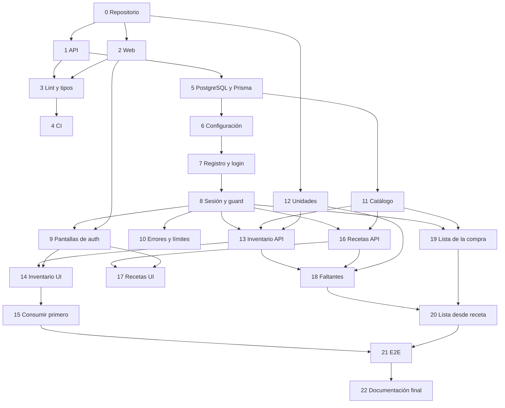

# Hoja de ruta de PantryMind

Estado: **en desarrollo**. Las Issues 0, 1 y 2 están cerradas; el resto, pendientes.
Este documento refleja el plan, no el avance real. Actualízalo al cerrar cada Issue.

## Cómo leer este documento

- Cada Issue es pequeña y verificable. El detalle completo (alcance, tareas, Definition of Done) se redacta al abrirla en GitHub.
- **Depende de** indica qué debe estar cerrado antes de empezar.
- **Verificación** es la evidencia mínima para darla por cerrada.
- La numeración empieza en 0 y coincide con la de las Issues del proyecto.

## Resumen de fases

| Fase | Objetivo                  | Issues      | Hito al terminar                                                |
| ---- | ------------------------- | ----------- | --------------------------------------------------------------- |
| 0    | Cimientos del repositorio | 0–4         | Monorepo con API y web vacías, lint y CI en verde               |
| 1    | Datos y autenticación     | 5–10        | Un usuario puede registrarse e iniciar sesión                   |
| 2    | Inventario                | 11–15       | Un usuario gestiona su inventario y ve qué consumir primero     |
| 3    | Recetas y compra          | 16–20       | De una receta se obtiene la lista de la compra con lo que falta |
| 4    | Cierre del MVP            | 21–22       | Flujo completo probado de extremo a extremo y documentado       |
| 5+   | Fases posteriores         | por definir | Planificación, presupuesto, IA, móvil, despliegue               |

---

## Fase 0. Cimientos

### 0. Inicializar repositorio y estructura del monorepo

- **Estado:** cerrada.
- **Depende de:** nada.
- **Entregable:** npm workspaces, carpetas `apps/api`, `apps/web`, `docs/adr`; `.gitignore`, `.gitattributes`, `.editorconfig`, `.nvmrc`, `.env.example`; README inicial; ADR 0001.
- **Verificación:** `npm install` en la raíz sin errores; `git ls-files --eol` muestra `i/lf`; README visible en GitHub.
- **Demuestra:** preparación de un repositorio colaborativo y multiplataforma.

### 1. Scaffold de la API con NestJS

- **Estado:** cerrada.
- **Depende de:** 0.
- **Entregable:** aplicación NestJS en `apps/api` con `GET /health` y un test.
- **Verificación:** la API arranca en local; el endpoint responde 200; el test pasa.
- **Demuestra:** estructura básica de NestJS (módulo, controlador, test).

### 2. Scaffold de la web con React y Vite

- **Estado:** cerrada.
- **Depende de:** 0.
- **Entregable:** aplicación React + TypeScript en `apps/web` con una página inicial y un test de componente.
- **Verificación:** el servidor de desarrollo arranca; `build` termina sin errores; el test pasa.
- **Demuestra:** configuración de un frontend moderno con TypeScript.

### 3. Linting, formato y comprobación de tipos

- **Depende de:** 1, 2.
- **Entregable:** oxlint y Prettier configurados de forma coherente en los dos workspaces; scripts raíz `lint`, `format`, `typecheck`, `test`; limpieza pendiente del scaffold de la API: decidir si se conserva `@nestjs/mau` y el script `deploy`, alinear la versión del paquete (`0.0.1`) con el resto del repositorio y revisar el resultado de `npm audit`.
- **Verificación:** los cuatro scripts se ejecutan desde la raíz y terminan sin errores.
- **Demuestra:** calidad de código automatizada.

### 4. Integración continua

- **Depende de:** 3.
- **Entregable:** workflow de GitHub Actions que ejecuta lint, typecheck, test y build en Windows y Linux.
- **Verificación:** el workflow termina en verde en ambos sistemas en un pull request.
- **Demuestra:** CI y portabilidad comprobada, no supuesta.

---

## Fase 1. Datos y autenticación

### 5. PostgreSQL local, Prisma y primera migración

- **Depende de:** 1.
- **Entregable:** PostgreSQL en local (Docker Compose o instalación nativa, según el diagnóstico); Prisma configurado; modelo `User`; primera migración; guías de Windows y Linux iniciadas.
- **Verificación:** la migración se aplica en una base de datos vacía; un test de integración lee y escribe un usuario.
- **Demuestra:** bases de datos relacionales, ORM y migraciones versionadas.

### 6. Configuración por variables de entorno

- **Depende de:** 5.
- **Entregable:** módulo de configuración con validación al arrancar; `.env.example` completo; guía de variables.
- **Verificación:** la API se niega a arrancar con una variable obligatoria ausente y muestra un mensaje claro.
- **Demuestra:** gestión segura de configuración y secretos.

### 7. Registro e inicio de sesión en la API

- **Depende de:** 6.
- **Entregable:** `POST /auth/register` y `POST /auth/login`; hash de contraseñas; validación de entradas.
- **Verificación:** tests de registro correcto, correo duplicado, contraseña incorrecta y entradas inválidas; la contraseña nunca aparece en respuestas ni logs.
- **Demuestra:** autenticación y validación en el backend.

### 8. Sesión, refresh token y guard de autorización

- **Depende de:** 7.
- **Entregable:** token de acceso corto, refresh token rotatorio en cookie httpOnly, logout, guard reutilizable, `GET /users/me`; ADR de autenticación.
- **Verificación:** tests de ruta protegida sin token (401), token caducado, refresh válido y refresh reutilizado.
- **Demuestra:** gestión de sesiones y protección de rutas.

### 9. Pantallas de registro e inicio de sesión

- **Depende de:** 2, 8.
- **Entregable:** formularios con validación, cliente HTTP, rutas protegidas en el frontend, cierre de sesión.
- **Verificación:** tests de componentes de los formularios; flujo manual registro → login → página protegida → logout.
- **Demuestra:** formularios, enrutado y consumo de una API autenticada.

### 10. Gestión de errores y límite de peticiones

- **Depende de:** 8.
- **Entregable:** filtro global de excepciones con formato de error uniforme; límite de peticiones en los endpoints de autenticación.
- **Verificación:** tests que comprueban el formato de error y que no se filtran detalles internos; test del límite.
- **Demuestra:** robustez y seguridad básica de una API.

---

## Fase 2. Inventario

### 11. Catálogo de alimentos

- **Depende de:** 5.
- **Entregable:** modelo `FoodItem` (nombre, categoría, dimensión de unidad); datos semilla reproducibles; endpoint de búsqueda; ADR del catálogo.
- **Verificación:** el seed se ejecuta dos veces sin duplicar datos; tests del endpoint de búsqueda.
- **Demuestra:** modelado de datos y datos de prueba reproducibles.

### 12. Lógica de unidades y cantidades

- **Depende de:** 0.
- **Entregable:** funciones puras para convertir a unidad base, sumar, restar y comparar cantidades de la misma dimensión; reglas de redondeo documentadas.
- **Verificación:** tests unitarios con casos límite (cero, decimales, dimensiones incompatibles).
- **Demuestra:** reglas de negocio aisladas y testeadas sin base de datos.

### 13. CRUD de inventario en la API

- **Depende de:** 8, 11, 12.
- **Entregable:** modelo `InventoryItem` (cantidad, ubicación, fechas, tipo de fecha, precio en céntimos, notas); endpoints de alta, consulta, edición, baja y ajuste de cantidad.
- **Verificación:** tests de API de cada operación; tests de autorización que prueban que un usuario no puede leer ni modificar datos de otro.
- **Demuestra:** API REST completa con autorización por recurso.

### 14. Interfaz de inventario

- **Depende de:** 9, 13.
- **Entregable:** listado con filtro por ubicación, formularios de alta y edición, eliminación con confirmación, estados de carga y error.
- **Verificación:** tests de componentes; recorrido manual en escritorio y en ancho de móvil.
- **Demuestra:** interfaz responsive conectada a datos reales.

### 15. Vista "consumir primero"

- **Depende de:** 13, 14.
- **Entregable:** endpoint que ordena por urgencia distinguiendo caducidad de consumo preferente; vista en la web que diferencia dato registrado de recomendación.
- **Verificación:** tests unitarios de la regla de ordenación, incluidos alimentos sin fecha y fechas ya pasadas.
- **Demuestra:** lógica de dominio con fechas tratada con rigor.

---

## Fase 3. Recetas y compra

### 16. Recetas en la API

- **Depende de:** 8, 11.
- **Entregable:** modelos `Recipe`, `RecipeIngredient`, `RecipeStep`; CRUD; campo de origen (verificada, propia) preparado para marcar las generadas por IA más adelante.
- **Verificación:** tests de API y de autorización; creación de receta con ingredientes en una transacción.
- **Demuestra:** relaciones, integridad referencial y transacciones.

### 17. Interfaz de recetas

- **Depende de:** 9, 16.
- **Entregable:** listado, detalle con pasos ordenados, formulario de creación y edición con ingredientes dinámicos, filtro por tiempo de preparación.
- **Verificación:** tests de componentes del formulario dinámico.
- **Demuestra:** formularios complejos en React.

### 18. Cálculo de ingredientes disponibles y faltantes

- **Depende de:** 12, 13, 16.
- **Entregable:** servicio determinista que compara una receta con el inventario y devuelve, por ingrediente, cantidad disponible y faltante; endpoint y vista en el detalle de la receta.
- **Verificación:** tests unitarios con inventario vacío, parcial, suficiente y con varios lotes del mismo alimento.
- **Demuestra:** la regla de negocio central del producto.

### 19. Lista de la compra

- **Depende de:** 8, 11.
- **Entregable:** modelos `ShoppingList` y `ShoppingListItem`; añadir, editar, eliminar, marcar como comprado, precio real opcional; interfaz.
- **Verificación:** tests de API y autorización; tests de componentes.
- **Demuestra:** un segundo dominio completo construido con los mismos patrones.

### 20. Generar la lista desde una receta

- **Depende de:** 18, 19.
- **Entregable:** acción que añade a la lista los faltantes de una receta, sumando cantidades si el alimento ya está en la lista.
- **Verificación:** tests de la fusión sin duplicados; operación atómica comprobada.
- **Demuestra:** integración entre módulos sin acoplarlos.

---

## Fase 4. Cierre del MVP

### 21. Tests de extremo a extremo

- **Depende de:** 15, 20.
- **Entregable:** pruebas con Playwright del flujo registro → inventario → receta → faltantes → lista de la compra; ejecución en CI.
- **Verificación:** las pruebas pasan en local y en CI.
- **Demuestra:** testing end-to-end de un flujo real.

### 22. Documentación final del MVP

- **Depende de:** 21.
- **Entregable:** README completo, OpenAPI revisado, diagrama entidad-relación, diagrama de componentes, documento de seguridad y privacidad, guías de Windows y Linux revisadas, CHANGELOG con la versión 0.1.0.
- **Verificación:** una instalación desde cero siguiendo solo la documentación llega a tener la aplicación funcionando.
- **Demuestra:** capacidad de entregar un proyecto que otra persona puede usar.

---

## Fases posteriores (sin detallar todavía)

Se desglosarán en Issues al llegar a cada una, con lo aprendido en el MVP.

| Fase | Contenido                                                           | Condición para empezar                              |
| ---- | ------------------------------------------------------------------- | --------------------------------------------------- |
| 5    | Planificación de comidas y lista de la compra desde un plan         | MVP cerrado                                         |
| 6    | Presupuesto, registro de consumo y desperdicio                      | MVP cerrado                                         |
| 7    | IA de texto: recetas generadas, validadas y marcadas como tales     | Proveedor elegido con precios y límites verificados |
| 8    | IA de visión: tickets y fotos, siempre con confirmación del usuario | Fase 7                                              |
| 9    | Voz                                                                 | Fase 7                                              |
| 10   | Aplicación móvil con Capacitor                                      | Revisar el ADR de autenticación                     |
| 11   | Despliegue en Linux con nginx, HTTPS y copias de seguridad          | Coste explicado y confirmado                        |
| 12   | Hogares compartidos                                                 | Necesidad real confirmada                           |

## Dependencias entre Issues del MVP

## Reglas de la hoja de ruta

- No se empieza una Issue con dependencias abiertas.
- Cada Issue incluye sus propios tests y su documentación.
- Si una Issue crece demasiado, se divide antes de implementarla.
- Los cambios de alcance se anotan aquí y, si afectan a la arquitectura, en un ADR.
